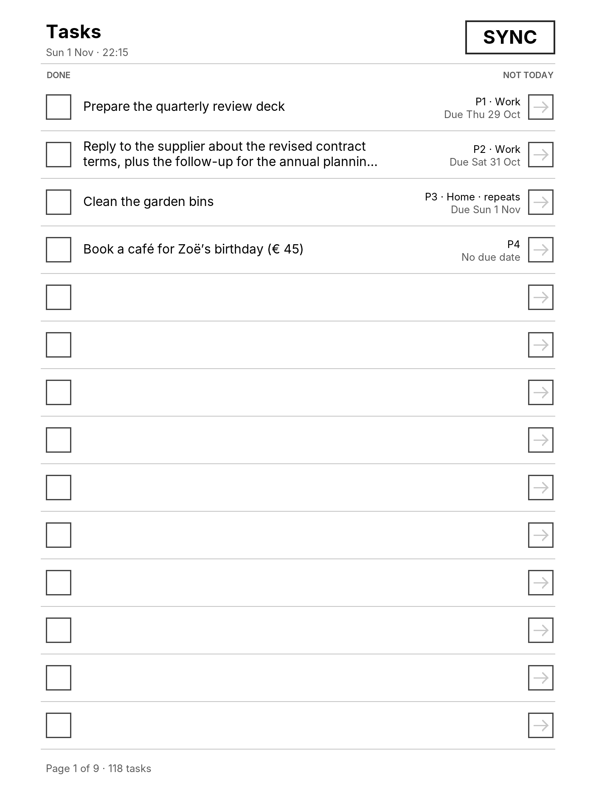
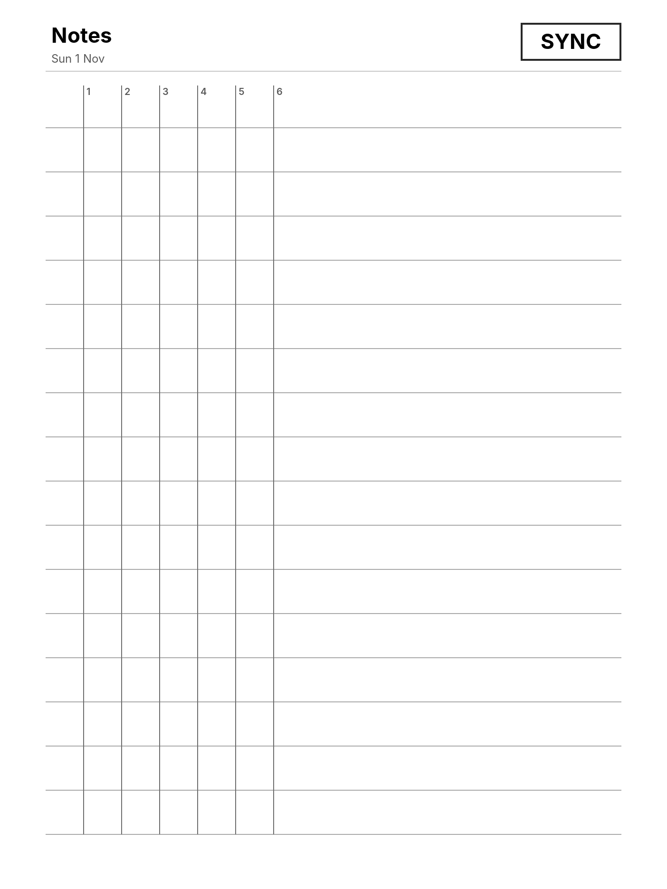

# Tana Sync for Supernote

A Supernote plugin and a small Cloudflare Worker that connect a Supernote
Nomad to Tana Outliner:

- **Tasks:** today's tasks from Tana are written onto a daily page. Tick one with
  the pen and it is completed in Tana.
- **Writing:** handwriting on the same page, with dashes and indentation like an
  outline, becomes nodes on that day's node in Tana.

The full design is in [docs/DESIGN.md](docs/DESIGN.md).

**Status: v0.6.** The daily loop works on a Nomad (firmware 3.31.45): a
Tasks notebook to tick things off, a Notes page to write on, and a SYNC box on
every page that sends it all to Tana after you confirm. Handwriting
recognition is the Nomad's own, so tidy writing helps.

## Layout

| Path | What |
| --- | --- |
| `plugin/` | React Native Supernote plugin (`sn-plugin-lib`), built into `TanaSync.snplg` |
| `plugin/src/app/` | The flows: Today, Sync, the offline outbox, the Self-test, panel state |
| `plugin/src/render/` | Draws the Today page in plain JavaScript: PNG encoder, bitmap font, page layout |
| `plugin/src/core/` | Reading the pen: tick and "Not today" detection, grouping strokes into lines and indent levels, outline rules. Unit-tested |
| `plugin/tools/` | Scripts that draw the toolbar icons and the font atlas |
| `worker/` | Cloudflare Worker. It logs in to Tana's hosted MCP (OAuth), builds the task snapshot, and applies your ticks and notes |
| `.github/workflows/ci.yml` | Typecheck, lint and tests for both parts. Builds the `.snplg` as a downloadable artifact |

## Use it on the Nomad

Two screens, two notebooks in `Note/Tana`:

- **Tasks** (`Tasks <date>.note`): every open task, P1 first and the oldest due date first inside a priority. 14 tasks a page; flip through with the normal page turn.
- **Notes** (`Notes <date>.note`): today's page for writing. Everything you write goes to today's node in Tana.

1. **Download the plugin.** Open the latest **CI** run on `main` on GitHub and
   download the **TanaSync-snplg** artifact. Unzip it to get
   `TanaSync.snplg` (upload that file, not the zip).
2. **Copy it to the Nomad.** Put it directly in the `MyStyle` folder. On a
   Mac, *Browse & Access* over Wi-Fi is easiest.
3. **Install it.** On the Nomad, go to *Settings → Apps → Plugins → Choose
   Installation Package* and pick `TanaSync.snplg`. To update, install the new
   file the same way.
4. **Allow file access.** In *Settings → Apps → Plugins → Tana Sync*, allow
   file read and write (**Always allow**). Internet access is asked on first use.
5. **Configure.** Open any notebook and tap **Tana** in the toolbar. Tap
   **Config**, enter the Worker URL and the device passphrase, **Save**, **Back**.
6. **Tasks.** In the panel, choose what to show with the buttons under *Show*
   (P1–P4, Home, Work; none selected = everything), then tap **Tasks**. A
   notebook opens with your tasks.
   - Tick the box on the left, or strike through the task: **done**.
   - Mark the arrow box on the right: **not today**. The task's due date moves
     to tomorrow, unless it is already later.
7. **Notes.** Tap **Notes**. The first time it makes today's notebook, after
   that it opens it, and tapping it while it is open adds another page.
   Write with a dash for each item; start further right (the numbered lines)
   for a sub-item; start with a small box for a task.
8. **Sync.** Tap the **SYNC** box at the top right of the page with the pen.
   The panel opens with what it found: done, not today, and the recognised
   handwriting. Check it, then tap **Send to Tana**; the panel closes by
   itself. (The toolbar **Sync** button in the panel does the same.) Without a
   connection, changes wait in an outbox and go out at the next Sync.
9. **If something is off,** tap **Self-test** in the panel's bottom right. It
   tries every device call the plugin needs, shows PASS or FAIL for each and
   uploads the result.

Everything written to Tana is in English; nothing is ever deleted from Tana by
a mark on paper.





## Worker

```sh
cd worker
npm ci
npx wrangler login
npx wrangler deploy        # also after every update: /sync and /notes are new in v0.5
# sha256 of the passphrase (macOS: shasum -a 256, Linux: sha256sum)
printf '%s' 'four random words here' | shasum -a 256 | cut -d' ' -f1 | npx wrangler secret put DEVICE_TOKEN_HASH
```

To link Tana, open `https://<worker-host>/oauth/start?token=<passphrase>` in a
browser and approve. After that, `/health` reports `"tana": "linked"`.

| Endpoint | Purpose |
| --- | --- |
| `GET /health` | Shows whether Tana is linked and how old the task snapshot is |
| `GET /oauth/start`, `GET /oauth/callback` | One-time link to Tana |
| `GET /tasks?view=today\|all` | Task snapshot: P1 first, oldest due date first inside a priority. `view=all` takes `&priority=P1,P2` and `&domain=Home,Work`. Rebuilt when older than 10 minutes, or with `&fresh=1` |
| `POST /sync`, `GET /sync/log` | Applies `done` and `postpone` ("Not today") actions to tasks in Tana; the log keeps the last 30 results |
| `POST /notes` | Imports handwritten notes as nodes on a day's node |
| `POST /spike/report`, `GET /spike/report` | Findings and the event log sent from the Nomad |
| `GET /spike/mcp` | Diagnostics: MCP tools, snapshot timing and counts |
| `POST /spike/import-test` | Imports one "Supernote sync test" node on today's day node and returns Tana's raw reply |

Every endpoint except `/` and `/oauth/callback` needs the passphrase as a
bearer token.

## Development

```sh
cd plugin && npm ci
npm test && npm run typecheck && npm run lint
bash buildPlugin.sh                 # → build/outputs/TanaSync.snplg

cd ../worker && npm ci
npm test && npm run typecheck
```

To run the Worker locally against a stand-in Tana (130 tasks, two workspaces):

```sh
node scripts/mock-mcp.mjs &
npx wrangler dev --var TANA_MCP_URL:http://127.0.0.1:8788/mcp --var DEV_TANA_ACCESS_TOKEN:dev \
  --var DEVICE_TOKEN_HASH:$(printf '%s' test | shasum -a 256 | cut -d' ' -f1)
curl -H 'authorization: Bearer test' 'localhost:8787/tasks?view=today'
```

The task list is built in the background, in batches of 35 calls to Tana:
Cloudflare's free plan allows 50 outbound requests per Worker invocation. The
first `/tasks` call returns an empty list with `refreshing` progress. Later
calls return the finished snapshot, which is refreshed when it is older than
10 minutes.
