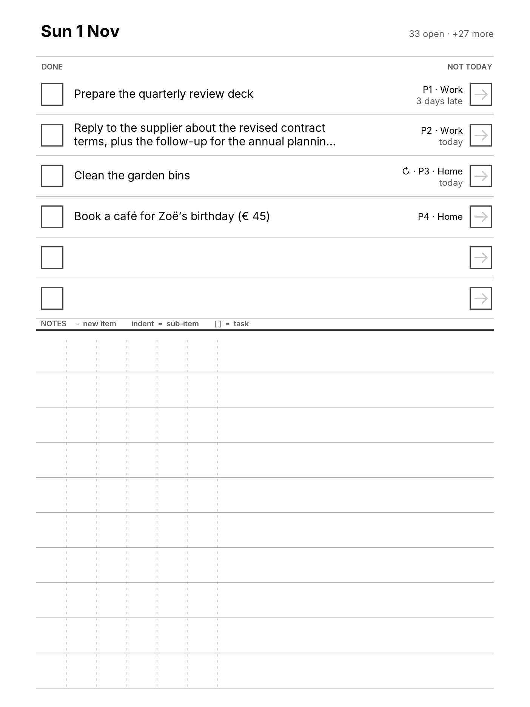

# Tana Sync for Supernote

A Supernote plugin and a small Cloudflare Worker that connect a Supernote
Nomad to Tana Outliner:

- **Tasks:** today's tasks from Tana are written onto a daily page. Tick one with
  the pen and it is completed in Tana.
- **Writing:** handwriting on the same page, with dashes and indentation like an
  outline, becomes nodes on that day's node in Tana.

The full design is in [docs/DESIGN.md](docs/DESIGN.md).

**Status: v0.5, first full build of the daily loop.** Today draws your most
urgent tasks onto a page, Sync reads your ticks and handwriting and (after you
confirm) updates Tana. It has been tested against a scripted device and a
mock of Tana, and has **not yet been confirmed on a Nomad**: the **Self-test**
button exists to find out, in one run, which device calls work on your
firmware.

## Layout

| Path | What |
| --- | --- |
| `plugin/` | React Native Supernote plugin (`sn-plugin-lib`), built into `TanaSync.snplg` |
| `plugin/src/app/` | The flows: Today, Sync, the offline outbox, the Self-test, panel state |
| `plugin/src/render/` | Draws the Today page in plain JavaScript: PNG encoder, bitmap font, page layout |
| `plugin/src/core/` | Reading the pen: tick and "Not today" detection, grouping strokes into lines and indent levels, outline rules. Unit-tested |
| `plugin/tools/` | Scripts that draw the toolbar icons and the font atlas |
| `worker/` | Cloudflare Worker. It logs in to Tana's hosted MCP (OAuth), builds the task snapshot, and applies your ticks and notes |
| `.github/workflows/ci.yml` | Typecheck, lint and tests for both parts. Builds the `.snplg` as a downloadable artifact |

## Use it on the Nomad

1. **Download the plugin.** Open the latest **CI** run on `main` on GitHub and
   download the **TanaSync-snplg** artifact. Unzip it to get
   `TanaSync.snplg` (upload that file, not the zip).
2. **Copy it to the Nomad.** Put it directly in the `MyStyle` folder. On a
   Mac, *Browse & Access* over Wi-Fi is easiest; USB needs an app such as
   OpenMTP.
3. **Install it.** On the Nomad, go to *Settings → Apps → Plugins → Choose
   Installation Package* and pick `TanaSync.snplg`. Copying the file alone
   does not install it. To update, install the new file the same way.
4. **Allow file access.** In *Settings → Apps → Plugins → Tana Sync*, allow
   file read and write (**Always allow**). Internet access is asked on first
   use.
5. **Configure.** Open any notebook and tap **Tana** in the toolbar. Tap
   **Config**, enter the Worker URL and the device passphrase, tap **Save**,
   then **Back**.
6. **Self-test (first time).** Tap **Self-test**. It tries every device call
   the plugin needs and lists PASS or FAIL for each, then uploads the result.
   Write something on a page first if you want it to test reading strokes.
7. **Today.** Tap **Today**. The plugin creates `Note/Tana/<date>.note` with
   your six most urgent tasks and opens it. Tap Today again for a fresh page
   (`<date> b.note`, …), for example after you have worked through the first.
8. **Work the page.**
   - Tick the box left of a task, or strike through it: **done**.
   - Mark the arrow box on the right: **not today**. The task moves to tomorrow.
   - Write below the line. A dash starts a note, indenting makes it a
     sub-note, a small box makes it a task.
9. **Sync.** Tap **Sync**. It lists what it found. Check the recognised
   handwriting, then tap **Send to Tana**. Without a connection, the changes
   wait in an outbox and go out at the next Sync or Today.

Everything written to Tana is in English; nothing is ever deleted from Tana by
a mark on paper.



## Worker

```sh
cd worker
npm ci
npx wrangler login
npx wrangler deploy        # also after every update: /sync and /notes are new in v0.5
# sha256 of the passphrase (macOS: shasum -a 256, Linux: sha256sum)
printf '%s' 'four random words here' | shasum -a 256 | cut -d' ' -f1 | npx wrangler secret put DEVICE_TOKEN_HASH
```

To link Tana, open `https://<worker-host>/oauth/start?token=<passphrase>` in a
browser and approve. After that, `/health` reports `"tana": "linked"`.

| Endpoint | Purpose |
| --- | --- |
| `GET /health` | Shows whether Tana is linked and how old the task snapshot is |
| `GET /oauth/start`, `GET /oauth/callback` | One-time link to Tana |
| `GET /tasks?view=today\|all` | Task snapshot, most urgent first. Rebuilt when older than 10 minutes, or with `&fresh=1` |
| `POST /sync` | Applies `done` and `postpone` ("Not today") actions to tasks in Tana |
| `POST /notes` | Imports handwritten notes as nodes on a day's node |
| `POST /spike/report`, `GET /spike/report` | Findings and the event log sent from the Nomad |
| `GET /spike/mcp` | Diagnostics: MCP tools, snapshot timing and counts |
| `POST /spike/import-test` | Imports one "Supernote sync test" node on today's day node and returns Tana's raw reply |

Every endpoint except `/` and `/oauth/callback` needs the passphrase as a
bearer token.

## Development

```sh
cd plugin && npm ci
npm test && npm run typecheck && npm run lint
bash buildPlugin.sh                 # → build/outputs/TanaSync.snplg
python3 tools/make_template.py      # after changing src/core/layout.json

cd ../worker && npm ci
npm test && npm run typecheck
```

To run the Worker locally against a stand-in Tana (130 tasks, two workspaces):

```sh
node scripts/mock-mcp.mjs &
npx wrangler dev --var TANA_MCP_URL:http://127.0.0.1:8788/mcp --var DEV_TANA_ACCESS_TOKEN:dev \
  --var DEVICE_TOKEN_HASH:$(printf '%s' test | shasum -a 256 | cut -d' ' -f1)
curl -H 'authorization: Bearer test' 'localhost:8787/tasks?view=today'
```

The task list is built in the background, in batches of 35 calls to Tana:
Cloudflare's free plan allows 50 outbound requests per Worker invocation. The
first `/tasks` call returns an empty list with `refreshing` progress. Later
calls return the finished snapshot, which is refreshed when it is older than
10 minutes.
