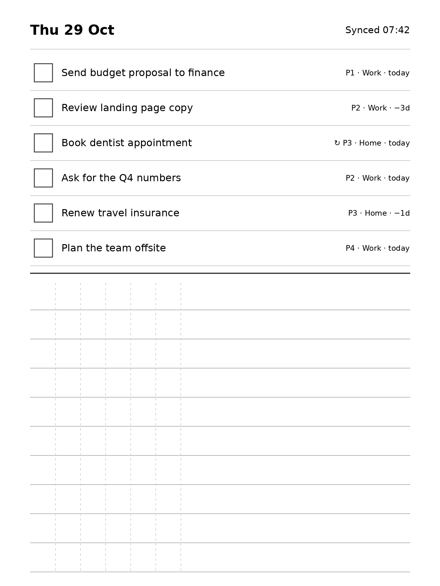
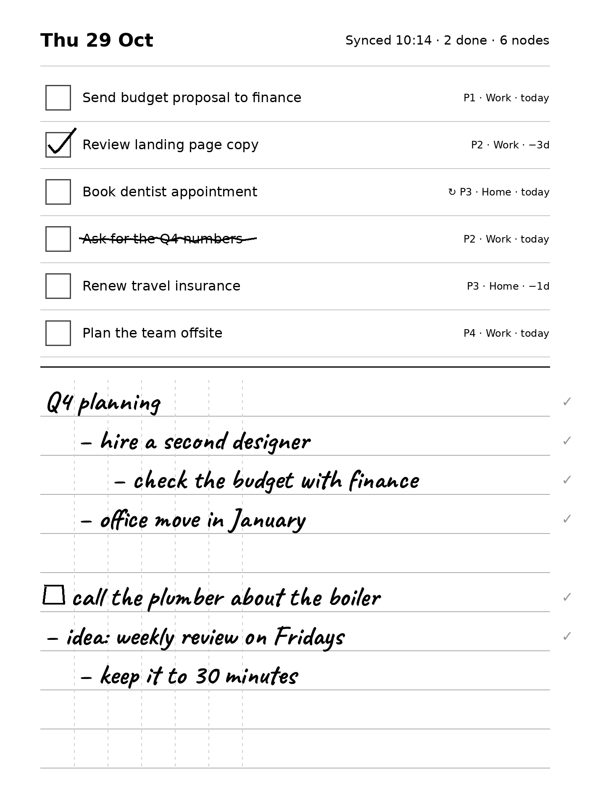
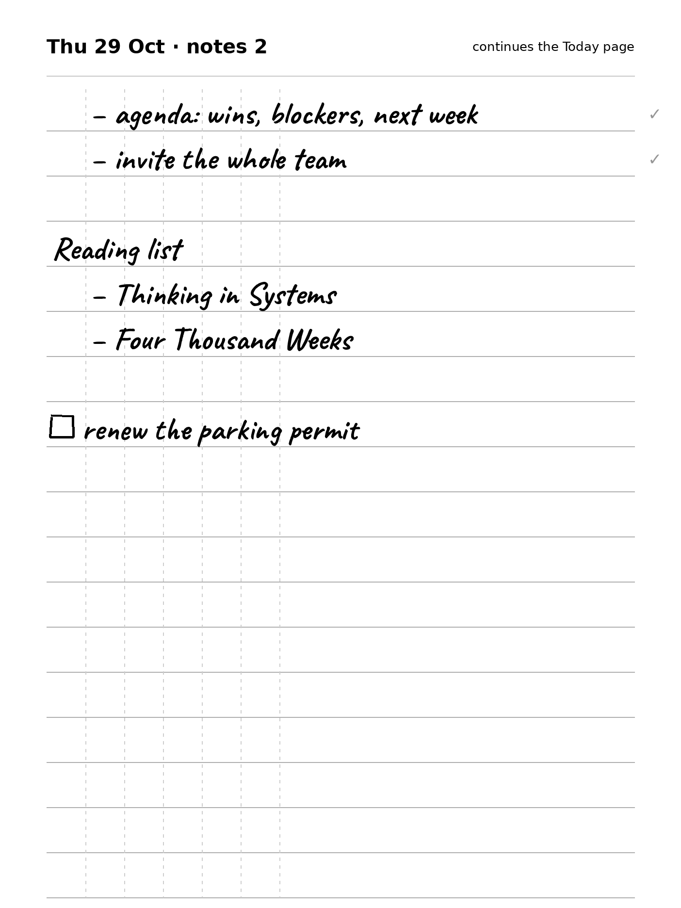
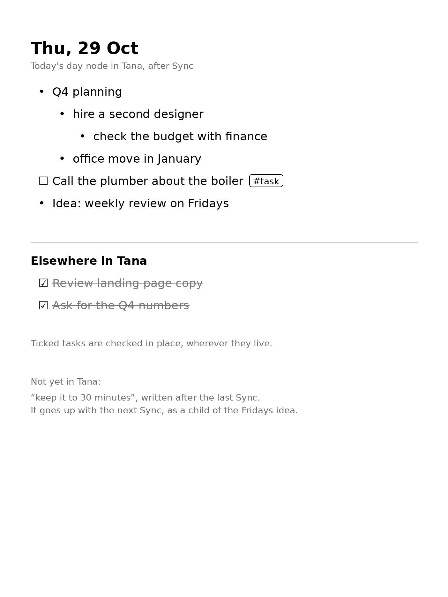
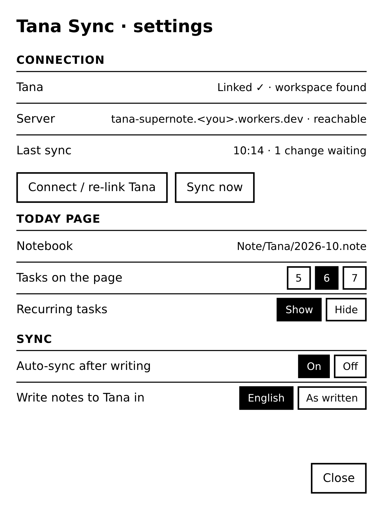
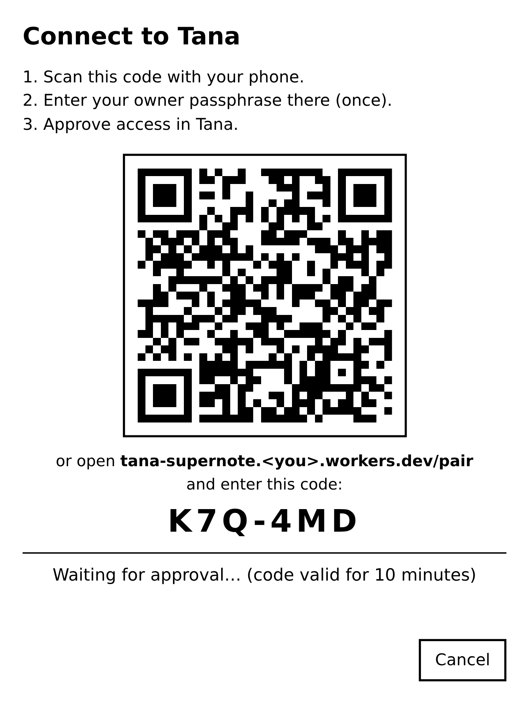
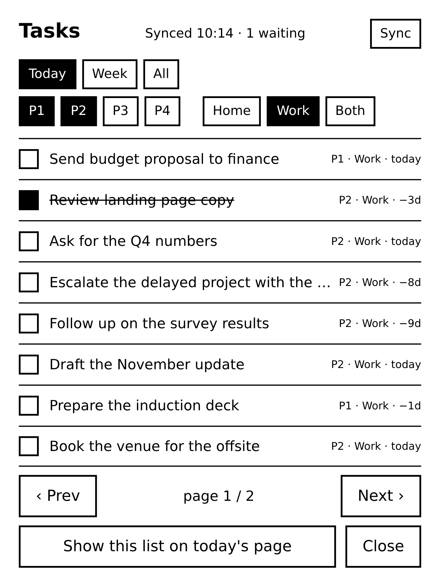
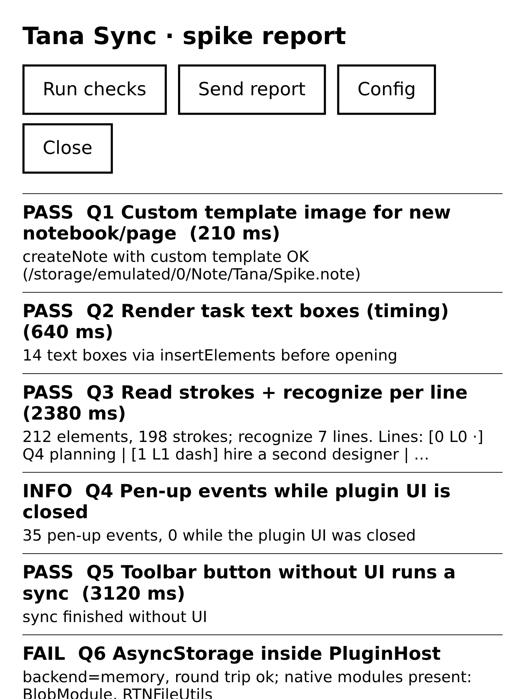

# Design: Supernote ⇄ Tana Outliner

Status: **design v2**, 2026-10-29. The M0 spike is built (see
[README](../README.md)); everything else here is design. v1 of this doc (a
sideloaded app with a separate canvas) is superseded: the plugin route is
confirmed.

The screens below are mockups at the Nomad's resolution (1404 × 1872), drawn
from the same `layout.json` and template the plugin uses. Handwriting is
simulated with a handwriting font.

## TL;DR

**One "Today page" per day** in a Supernote notebook. A plugin draws your
tasks from Tana at the top; below them you write freely. A **Sync** button,
plus optional quiet auto-sync, closes the loop:

- **Ticking a box** (or striking a task through) with the pen marks that task
  done in Tana.
- **Writing in the lower half**, using dashes and indentation like an outline,
  becomes nodes on *that day's* page in Tana, with the same hierarchy.
- A **Tasks panel**, one tap from the toolbar, lets you browse all tasks with
  filters (P1–P4, Home/Work, Today/Week/All) and Prev/Next paging. You can
  complete tasks there, or send the current list to the page.
- **Everything works offline.** Ticks and writing are kept on the device and
  sent when Wi-Fi is back. The page's date decides which Tana day node the
  writing goes to, not the time of syncing.
- **Run out of room?** Turn the page. Each day has as many notes pages as you
  need, and they continue the same outline.
- **Connecting** is a QR code: scan it with your phone, approve in Tana, done.
  Nothing is typed on the Nomad.

The plugin SDK supports all of these. The remaining unknowns are listed in
§10 and are cheap to test in a one-to-two-day spike.

---

## 1. The Today page

Nomad page: 1404 × 1872 px at 300 ppi, so 1 mm ≈ 11.8 px. We read the exact
size at runtime with `getPageSize`.

| After tapping **Today** | After ticking, writing and **Sync** |
| --- | --- |
|  |  |

On the right:
- Row 2 is ticked in its box and row 4 is struck through: both are done.
- ↻ marks a recurring task.
- The writing uses dashes and indent guides as an outline. The ☐ line becomes
  a new #task.
- The small gray ✓ on the right means "this line is in Tana". The last line
  was written after the sync, so it has none yet.

Each part of the page has an owner:

| Part | Owner | What it is |
| --- | --- | --- |
| Checkbox squares, row lines, divider, ruled lines, indent guides | **Template** (a background image we ship) | Never changes, can't be erased, costs nothing to render. |
| Header, task names, meta (priority, Home/Work, due), ✓ sync marks | **Plugin** | Text boxes on the page, set to non-editable. |
| Ticks, strike-throughs, writing | **You** | Normal pen strokes, read by the plugin when it syncs. |

### Proposed sizes

| Zone | Size |
| --- | --- |
| Header | ~130 px |
| Task zone | 6 rows × 110 px (≈ 9.3 mm each, a comfortable target for a tick) |
| Writing zone | ~10 ruled lines × 93 px (≈ 8 mm, like Supernote's lined templates) |
| Indent guides | every 80 px (≈ 7 mm) |

### More writing room: notes pages



The writing zone on the Today page has ten lines. When it's full, **turn the
page**:

- **Today** always creates the day's page *plus one blank notes page* after
  it, so there is a page to turn to.
- A **notes page** is all ruled lines with the same indent guides, under a
  small "Thu 29 Oct · notes 2" header.
- When you start writing on the last notes page of the day, the next Sync
  adds another blank one. There is always a fresh page ahead, as in a paper
  notebook.
- **One outline per day.** All pages of a day are read as one continuous
  outline. An indented first line on a notes page continues under the last
  node of the page before. In the mockup, "agenda: …" becomes a child of
  "idea: weekly review on Fridays" from the Today page.
- **Dates come from the page.** Notes pages belong to the Today page before
  them, so writing on them later still lands on that day's node.
- The next morning's Today page goes after the last page of the previous
  day. An unused spare notes page is removed first, so the notebook doesn't
  fill up with blanks.
- **Unverified on the device:** what Supernote does when you swipe past the
  last page (spike Q10). If it adds a page with the same template, that works
  too. If not, the spare page above covers it.

<br clear="right">

---

## 2. A day with it

1. **Morning.** Open the *Tana* notebook and tap **Today** in the toolbar.
   - If today's page doesn't exist yet, the plugin adds it at the end and fills
     in the header and tasks.
   - It uses the cached list right away, then refreshes when online.
2. **During the day**, tick a box or strike a task through. Nothing else
   happens on screen: the ink is the feedback, like paper.
3. **Write** in the lower half: thoughts, meeting notes, or a ☐ line for a new
   task. Writing in an **empty task row** also creates a task.
4. **Sync.** Tap **Sync** in the toolbar, or let auto-sync run after a minute
   of pen inactivity. The plugin then:
   - sends completions and new lines to Tana,
   - puts a small gray ✓ next to each line now in Tana,
   - updates the header ("Synced 10:14" or "Offline · 3 waiting").
5. **Browse.** Tap **Tasks** in the toolbar for the full list (§6). Filter,
   page through, tick things off there, or "Show this list on the page".
6. **Next morning**, Today adds a new page. Yesterday's page stays as it is,
   a paper log. If you add something to yesterday's page later, it syncs to
   **yesterday's** day node in Tana.

---

## 3. Handwriting → outline

The grammar is deliberately small and reads like Tana:

| You write | Becomes in Tana |
| --- | --- |
| A line starting with a dash `–` | A node. |
| Starting further right, at the next indent guide | A **child** of the node above. |
| A line with no dash, directly under a node at the same indent | **Continuation** of that node (a long thought that wraps). |
| A first line with no dash, or a line after an empty ruled line | A node (for headings and plain notes). |
| A small box `☐` at the start | A **#task** node. Deadline Date is the page's date, Priority stays at the default P3. This matches your #task rules. |
| Text in an empty task row | The same: a new **#task**. |
| Typed text boxes (Supernote keyboard) | Same rules. Leading `- ` and indentation are taken from the text. |

How the plugin reads a page (device side, works offline):

1. **Assign strokes to ruled lines.** Each stroke goes to the line slot that
   holds the median y of its points. The template's ruled lines make this
   reliable.
2. **Find each line's indent level.** Take the line's leftmost x, round it to
   the nearest indent guide, and cap it at *previous level + 1*.
3. **Detect markers.**
   - **Dash:** the first stroke of a line that is short, flat and followed by
     a gap.
   - **Box:** a small closed, roughly square first stroke.
4. **Recognize** each line's remaining strokes with the device's own
   recognizer (`recognizeElements`). This gives a draft text per line.

On sync, the Worker gives Claude the draft lines and a PNG of the page. Claude
returns **corrected English text per node**. It may merge wrapped lines into
one node, but it may not invent or reorder content. The Worker builds the Tana
Paste deterministically from that result.

**IDs make it incremental.**
- The plugin remembers which strokes became which Tana node.
- New lines later are appended, and a new indented line under an
  already-synced node becomes its child in Tana.
- **Paper never deletes in Tana.** Erasing synced writing does nothing there.
  Editing a synced line (adding words to it) updates that node's name (M5).

What the page above becomes in Tana:



---

## 4. Architecture

```
 Supernote Nomad
┌──────────────────────────────────────────────────────────────┐
│ NOTE app ── "Tana" notebook (one page per day)              │
│   toolbar: [Today] [Sync] [Tasks]   lasso toolbar: [→ Tana] │
│ PluginHost (React Native 0.79) ── "Tana" plugin             │
│   page renderer · stroke reader · outbox · task cache       │
│   listeners: pen-up (auto-sync, tick detection), lifecycle  │
└──────────────┬───────────────────────────────────────────────┘
               │ HTTPS · Bearer device token · only when online
┌──────────────▼───────────────────────────────────────────────┐
│ Cloudflare Worker (TypeScript)                               │
│   GET /tasks (snapshot)   POST /sync (batch of ops)          │
│   KV: opId → result (idempotency) · domain map cache         │
│   Durable Object "TanaSession": OAuth tokens + MCP client    │
│   secrets: OWNER_PASSPHRASE_HASH, ANTHROPIC_API_KEY          │
└──────┬───────────────────────────────────────┬───────────────┘
       │ MCP (Streamable HTTP, OAuth)          │ Messages API (image + text)
       ▼                                       ▼
  Tana Outliner hosted MCP (app.tana.inc/mcp)  Claude
```

These parts are unchanged from v1:
- Secrets live only in the Worker.
- The hosted Tana MCP is the only option: the local MCP needs the desktop app
  running, and the Input API is write-only.
- Changed since v1: no passphrase is typed on the Nomad. The device gets its
  own token by scanning a QR code (§5.7).

---

## 5. Plugin internals

### 5.1 Notebooks and pages

- **One notebook per month**, for example `Note/Tana/2026-10.note`, with one
  page per day plus continuation pages. This keeps files small and makes
  flipping back easy. The plugin creates it with `createNote` and our own
  template image.
- **Toolbar buttons** (shown in NOTE):
  - **Today** opens the month's notebook, adds today's page if needed
    (`insertNotePage` with the "Today" template) plus one blank notes page
    (§1), renders it and jumps to it.
  - **Sync** runs the sync and updates the header text. It can run without
    a view (spike Q5); while the spike runs it opens a small status view so
    errors are visible.
  - **Tasks** opens the task panel (§6).
- **Lasso button → Tana:** sends a lasso selection from *any* notebook,
  following the same grammar. It lands on the day node of the date you sync it
  (keeps the v1 idea).

### 5.2 Rendering

**Since v0.5 the page is drawn, not typed.** The plugin draws the whole page
(header, the six task rows, the "done" and "not today" boxes, the ruled
notes area) into a PNG on the device, writes it to `MyStyle/tana_today.png`
and creates a notebook with `createNote` using that image as its background.
Fonts are pre-rasterised from Inter (`tools/make_font.py`) and the PNG is
encoded in plain JavaScript (`src/render/`). This needs only two device calls
to show the page (create, open), and the page is crisp and exactly where
`layout.json` says it is. A new page for the same day is a new notebook
(`2026-11-01.note`, `2026-11-01 b.note`, …), because a notebook's background
image can be set at creation. Whether `insertNotePage` accepts an image path
is documented as "template name" only, and is tested by the self-test.

*The text-box approach below was the v0.1 to v0.4 design, kept for reference.*

- Text boxes go on the **main layer**. The SDK only allows text boxes there,
  so plugin text and your ink share a layer. They are inserted as
  **non-editable** (`textEditable: 1`) in one batch (`insertPageElements`).
- The plugin keeps the uuid of every element it drew, so it can tell its own
  elements apart from your ink.
- **Re-rendering the task zone happens only on request:** Today, a new list
  from the panel, or "Refresh tasks".
  - It replaces the plugin's row text.
  - It clears your ticks in that zone, which have been processed by then.
  - Sync itself never moves anything you can see. It only adds ✓ marks and
    updates the header.

### 5.3 Reading ticks

- A stroke belongs to row *r* when most of its points fall inside that row's
  band.
- **Done:** a stroke in the checkbox, or a long flat stroke across the task
  text (a strike-through).
- **Undo:** erase the tick.
  - Erased before sync: nothing is sent.
  - Erased after sync: the task is unchecked in Tana (one-off tasks only).
- **New task:** handwriting in an empty row's text area (§3).
- **Other ink** in a row with a task is ignored, so you can annotate.

### 5.4 Local state and outbox

- **Ledger** per page: date, rows (slot → task id), plugin element uuids, and
  lines (strokes → Tana node id and status).
- **Task cache:** the last snapshot from `GET /tasks`.
- **Outbox:** operations, each with a client `opId` so replays are harmless.
- **Storage:** JSON files in the plugin's private directory, written by a
  small native module of our own (`TanaNative`). PluginHost has no
  AsyncStorage (spike Q6).

### 5.5 Sync

1. Read the page (`getElements`). Diff it against the ledger to find new
   ticks, erased ticks, new lines and edited lines.
2. Queue ops into the outbox. **This step works offline.**
3. If online, send one `POST /sync` with all pending ops and apply the
   per-op results: node ids, ✓ marks, errors.
4. Pull `GET /tasks` (ETag, so cheap when unchanged) and update the header.

**Triggers:**
- the Sync button;
- opening Today;
- auto-sync, optional, about 60 s after the last pen-up, only if something
  changed. This relies on the pen-up listener running in the background, and
  the lifecycle docs say a stopped plugin "can still run in the background".

### 5.6 Permissions

All three are needed. Choose **"Always allow"** once for each:

| Permission | Why |
| --- | --- |
| `FILE:READ` | Read page elements and render a page PNG. |
| `FILE:WRITE` | Create notebooks and pages, insert text boxes. |
| `INTERNET` | Talk to the Worker. |

### 5.7 Settings and connecting to Tana

| Settings | Connect to Tana |
| --- | --- |
|  |  |

**Settings** opens from the plugin's entry in *Settings → Apps → Plugins*
(the SDK's config button) or from the Tasks panel. It shows:

- **Connection:** whether Tana is linked, whether the server is reachable,
  the last sync and how many changes are waiting.
  - **Connect / re-link Tana** opens the pairing screen.
  - **Sync now** runs a sync.
- **Today page:** which notebook is in use, how many tasks go on the page
  (5, 6 or 7), and whether recurring tasks are shown.
- **Sync:**
  - Auto-sync after writing, on or off.
  - Write notes to Tana in English, the default from the brief, or as written.

**Connecting uses a QR code instead of typing.** Typing a URL and passphrase
on an e-ink keyboard is the worst part of setup.

1. The plugin asks the Worker for a pairing (`POST /pair/start`). It gets back
   a short code and a link, and shows them as a QR code.
2. You scan the code with your phone. The page on the phone asks for your
   **owner passphrase**, once, on a real keyboard.
3. If Tana isn't linked yet, or you chose re-link, the phone goes on to
   Tana's own login and approval screen.
4. The plugin polls `GET /pair/status` every few seconds while the screen is
   open. When you approve, it receives **its own device token** and stores it.

Safety:
- Codes expire after 10 minutes and work once.
- Only someone with the owner passphrase can approve a device or re-link Tana.
- Device tokens are stored hashed in the Worker. "Forget this device" revokes
  one.
- The Worker URL is built into the plugin. It isn't a secret, and it can be
  changed under Advanced.

The M0 spike still uses the old Config screen (Worker URL + passphrase typed
in). Pairing comes with M1.

---

## 6. Tasks: the Today list, filters and paging

### 6.1 Data

`GET /tasks` returns a compact snapshot of **all open tasks**: one-off and
recurring, probably a few hundred, a few tens of KB. Filtering and paging then
happen **on the device**, so they work offline.

For each task:

| Field | Notes |
| --- | --- |
| `id`, `name` | |
| `priority` | P1–P4 |
| `deadline`, `someday` | |
| `domain` | Home or Work, resolved by the Worker: task → *Parent area or Project* → (project → *Parent Area*) → area → *Domain*. Tasks without an area show as "Unsorted". |
| `area` | |
| `recurring` | Occurrence included. |
| `delegated` | |
| `onDayNode` | Date of the day node the task lives on. |

### 6.2 Views

| View | Rule |
| --- | --- |
| **Today** (default on the page) | Unchecked, not Someday, Deadline ≤ today or living on today's day node. Excludes 🤖 routine tasks and `Decide:` items. |
| **This week** | Deadline ≤ Sunday. |
| **All** | Every open task. |

- **Filters** on top of any view: Priority (P1, P2, P3, P4, multi-select) and
  Domain (Home / Work / All).
- **Sort order:** by an urgency score, most urgent first. Priority sets the
  base (P1 100, P2 70, P3 40, P4 15). A deadline adds pressure: +25 when due
  today, then +3 for each day late, up to 14 days. A later deadline subtracts
  3 a day (up to 10 days). Being on today's day node adds 10. So a P1 due
  today (125) beats a P2 nine days late (122), while an old P4 (82 after two
  weeks) slowly climbs past a fresh P3 (65). Ties: older deadline, then name.
- **Not today:** a mark in the right-hand box sets the task's Deadline Date to
  tomorrow (unless it is already later). The task drops off today's list and
  comes back tomorrow, with its priority and lateness intact.
- **Paging:** 6 rows on the page, 8 in the panel, with ‹ Prev / Next › and
  "2 / 6".

### 6.3 Tasks panel (plugin UI, opened from Tasks)



The mockup shows view **Today**, **P1 + P2**, **Work**, page 1 of 2.

- Tapping a row ticks it, and the tick is queued like a tick on paper.
- Long names are cut off with "…".
- Drawing this at real size showed that eight rows only fit with compact
  filter chips, which is why Sync sits next to the title.

E-ink rules:
- Black on white only.
- No animations or spinners.
- Cached data first, then at most one repaint.

### 6.4 Recurring tasks

Your rule is that a #recurring task must **never** simply be checked: Tana's
*Complete and reschedule* command handles it, and MCP can't run commands. So
the Worker **emulates the command** when you tick one:

1. Move Deadline Date forward by its Occurrence. The Occurrence is one of the
   phrases your schema allows ("In seven days", "In four weeks", "In one
   month", "In one year").
2. Leave the task unchecked.
3. Write a checked history entry.

If the Occurrence can't be parsed, nothing changes and the row shows ⚠.
Undoing a recurring completion is manual in Tana.

---

## 7. Worker API

Requests from the device send `Authorization: Bearer <device token>`.

**Built in v0.5** (with the passphrase as bearer token, until pairing exists):

| Endpoint | Purpose |
| --- | --- |
| `GET /tasks?view=today` | The urgency-sorted Today list (see §6.2). |
| `POST /sync` | `{actions:[{type:"done"\|"postpone", id}]}`. Checks the node (a recurring task gets its deadline moved forward by *Occurrence*, repeated until after today, instead of being checked), or sets Deadline Date to tomorrow. Safe to repeat. Returns a result per action. |
| `POST /notes` | `{day, key, lines:[{level,text,isTask}]}`. Imports the lines as nodes on that day's node with `import_tana_paste`, once per `key`. |

**Pairing** (§5.7), without a device token:

| Endpoint | Purpose |
| --- | --- |
| `POST /pair/start` | Returns `{ code, url, pollToken }`. The plugin draws `url` as a QR code. |
| `GET /pair?code=…` | The phone page. Asks for the owner passphrase, then goes on to Tana OAuth if needed. |
| `GET /pair/status?pollToken=…` | `pending`, then `{ deviceToken }` once, then `expired`. |

**`GET /tasks`** returns the snapshot. It is ETag-cached.

```http
GET /tasks
→ 200 { "generatedAt": "…", "today": "2026-10-29",
        "tasks": [ { "id": "…", "name": "…", "priority": "P1", "deadline": "2026-10-29",
                     "someday": false, "domain": "work", "area": "…",
                     "recurring": null, "delegated": false, "onDayNode": null } ] }
```

**`POST /sync`** takes a batch of ops. Each op is idempotent per `opId`.

```http
POST /sync
{ "ops": [
  { "opId": "u1", "type": "complete",   "taskId": "…" },
  { "opId": "u2", "type": "uncomplete", "taskId": "…" },
  { "opId": "u3", "type": "lines", "date": "2026-10-29", "pagePng": "<base64, optional>",
    "lines": [ { "key": "p3:l4", "level": 0, "marker": "dash", "draft": "Q4 planning",
                 "parentNodeId": null },
               { "key": "p3:l5", "level": 1, "marker": "dash", "draft": "hire second designer",
                 "parentKey": "p3:l4" },
               { "key": "p3:l7", "level": 0, "marker": "box", "draft": "call the plumber" } ] }
] }
→ 200 { "results": [
  { "opId": "u1", "ok": true },
  { "opId": "u2", "ok": true },
  { "opId": "u3", "ok": true, "nodes": { "p3:l4": "nodeId…", "p3:l5": "nodeId…", "p3:l7": "nodeId…" } }
] }
```

**`complete`** behaves differently per task type:
- **One-off:** `check_node`.
- **Recurring:** the emulation in §6.4.

**`lines`** is processed in four steps:
1. `get_or_create_calendar_node(date)`.
2. Claude cleanup and translation into English.
3. Build the Tana Paste.
4. `import_tana_paste`, under the day node or under an existing parent node.

---

## 8. Rules for writing into Tana

- **Where:** the day node of the **page's date**, directly as nodes, with no
  wrapper node or #memo (decision 5).
- **Language:** everything written to Tana is **English**, as in the original
  brief. Handwriting in Dutch is translated, and the paper keeps your original.
- **New tasks** follow your #task rules:
  - tag #task,
  - on the day node,
  - Deadline Date filled in (never empty without Someday),
  - Priority at its default.
- **Never delete** anything in Tana from the device.
- **Conflicts:**
  - A task completed in Tana meanwhile turns a tick into a no-op.
  - A renamed task keeps its old text on the page until the next refresh.
    Ticks act on task ids, so they still hit the right task.

---

## 9. What we can build: milestones

| # | Milestone | Done when |
| --- | --- | --- |
| **M0** | Spike (1–2 days) | See §10: every unknown has a yes or no on your Nomad. |
| **M1** | Today page, read-only + connect | Settings and QR pairing (§5.7). Today creates the monthly notebook, today's page and a spare notes page from our templates, and renders header + 6 tasks from Tana. Sync refreshes. Works offline from cache. |
| **M2** | Ticks → Tana | Ticking or striking a task completes it in Tana (recurring included, via emulation). Erasing a tick before sync cancels it. Outbox and idempotency are proven by flipping Wi-Fi off and on. |
| **M3** | Writing → day node | Dash, indent, continuation and box grammar → nodes with hierarchy on the page's day node, in English. One outline across the day's notes pages, with a fresh spare page kept ready. ✓ marks. Later lines append to the right parent. |
| **M4** | Tasks panel | Filters (view, P1–P4, Home/Work), paging, tap to complete, "Show on page". |
| **M5** | Polish | Auto-sync on idle, quick-add in empty rows, lasso → Tana from other notebooks, typed text boxes, editing synced lines. |

**CI:** a GitHub Actions workflow builds the plugin package (`.snplg`) as a
downloadable artifact on every push. The Worker gets typecheck and tests.
Deploying the Worker is a manual `wrangler deploy`.

---

## 10. Unknowns to settle in the M0 spike

| # | Question | Fallback if "no" |
| --- | --- | --- |
| 1 | Does the device keep a custom **template image** for `createNote` / `insertNotePage`? | Draw the boxes and lines as geometry from the plugin. |
| 2 | How fast does inserting ~20 non-editable **text boxes** in one batch render on e-ink? | Fewer boxes: one text box per row, meta merged into the name. |
| 3 | Do `getElements` + `recognizeElements` **per line** give usable text for your handwriting, Dutch and English? | Rely more on Claude with the page PNG. |
| 4 | Does the **pen-up listener** fire while the plugin's UI is closed (auto-sync, instant tick detection)? | Sync button only. |
| 5 | Can a **toolbar button with no UI** (`showType: 0`) run the whole sync in the background? | The Sync button briefly opens a tiny status panel. |
| 6 | Is **AsyncStorage** (a native module) packaged and working inside PluginHost? | Our own native file module (chosen, see below). |
| 7 | Does `import_tana_paste` on the hosted MCP **return the new node ids**? | Read the day node's children after import and match by text. |
| 8 | Can our Worker **complete Tana's OAuth** as a non-Claude client, and how long do refresh tokens live? | Re-link from a phone when needed. The plugin shows "Re-link Tana". |
| 9 | Does the CI build of `.snplg` on Linux install and run on the device? | Build on a macOS runner. |
| 10 | When you swipe past the last page, does Supernote add a page, and with which template? | The plugin keeps a spare notes page ready (§1). |

The spike's report panel (the **Tana** button) lists these questions with
PASS, FAIL or INFO. The values in this mockup are examples; the real ones
come from your Nomad.



Results from the Nomad (firmware 3.31.45, plugins v0.1 and v0.2, 2026-10-30):

- **Install:** the `.snplg` built on Linux installs via *Settings → Apps →
  Plugins → Choose Installation Package*, and the plugin panel works (Q9 yes).
- **Q1: yes.** `insertNotePage` with our own template image in `MyStyle`
  added a page to the spike notebook.
- **Q5: yes.** v0.1's Today and Sync had no view (`showType: 0`) and still
  ran: Today added the templated page, and Sync started. An earlier read of
  the report said otherwise, because both runs then stopped on an error and
  nothing changed on screen. v0.2 and later give Today and Sync a status
  view anyway, so progress and errors are visible.
- **Both runs stopped on "undefined is not a function"** at the first
  `getPageSize` call. That fits a PluginHost without that native method.
  v0.3 checks which native methods exist and finds the page size another way
  (`getPageDisplaySize`, else the Nomad's 1404×1872).
- **Q4: yes.** Pen-up events arrived while writing on the page (17 in one
  test). The plugin view is full-screen, so these all came while it was
  closed. v0.1 counted none as "closed" because `closePluginView()` sends no
  lifecycle change.
- **Q6: no** AsyncStorage in PluginHost. The only native modules present are
  BlobModule, FileReaderModule and RTNFileUtils. v0.2's own native file store
  (`TanaNative`, built into the plugin's `app.npk`, the approach SuperDashboard
  uses) works: settings and the report survive a restart.
- **File permissions** have to be allowed in the plugin's settings; internet
  access was granted on first use.
- **Finger taps** reach the plugin through the motion listener. v0.2 drops
  the always-on listener anyway: SuperDashboard reports that global motion
  capture during page edits can freeze the device.

Partial answers from before the device test (2026-10-29):

- **Q8 (live, 2026-10-30):** the deployed Worker linked to Tana through
  OAuth as its own client and reads the real workspace. The first snapshot had
  118 open tasks (43 recurring); priority, deadline and Home/Work were filled
  in. Built in 5 background batches of 35 MCP calls, about 20 s, because the
  Workers free plan allows 50 outbound requests per invocation. Refresh-token
  lifetime is still to be observed.
- **Q8 (before deploy):** Tana publishes OAuth metadata with dynamic client registration,
  PKCE (S256), public clients and the refresh_token grant. A local run of the
  Worker registered itself and got a valid authorize redirect. Refresh-token
  lifetime is still unknown.
- **Q9:** `buildPlugin.sh` builds the `.snplg` on Linux as a pure JS bundle.
  `@react-native-async-storage` is not compiled in, because the script treats
  `@react-native*` packages as provided by the host. Whether the host really
  provides it is Q6.
- **Q7 (partly):** the hosted `import_tana_paste` accepts an `idempotencyKey`,
  so a retried sync can't create duplicate nodes.

---

## 11. Decisions

| # | Decision | Status |
| --- | --- | --- |
| 1 | Plugin, not a standalone app | **Decided** (you, 2026-10-29) |
| 2 | Offline first | **Decided** (you) |
| 3 | Tasks and writing on one page, plus a Sync button | **Decided** (you) |
| 4 | Notebook structure: one per month, a page per day | **Decided** (you, 2026-10-29) |
| 5 | Where writing lands: directly on the day node | **Decided** (you) |
| 6 | "Today" list rule (§6.2) | **Decided** (you) |
| 7 | Recurring tasks: show them, and emulate Complete and reschedule | **Decided** (you) |
| 8 | Everything in Tana is English | Assumed from the original brief. A setting allows "as written" (§5.7). |
| 9 | Notes pages: always one spare page ahead, one outline per day (§1) | Proposed |
| 10 | Connect by QR pairing, owner passphrase entered on the phone (§5.7) | Proposed |

---

## Sources

- Supernote plugin docs: <https://docs.supernote.com/llms.txt>. Pages used:
  - [Plugin principles](https://docs.supernote.com/en/principle.md)
  - [Your first plugin](https://docs.supernote.com/en/first-plugin.md)
  - [Permissions](https://docs.supernote.com/en/plugin-base/permission.md)
  - [Element operations](https://docs.supernote.com/en/plugin-base/file-op/element-op.md)
  - [Coordinate system](https://docs.supernote.com/en/plugin-base/coordinate-system.md)
  - [TextBox](https://docs.supernote.com/en/plugin-base/plugin-note/textbox.md)
  - API pages: `createNote`, `insertNotePage`, `insertText`, `insertPageElements`,
    `getElements`, `recognizeElements`, `registerEventListener`,
    `registerMotionListener`, `registerPluginLifeListener`, `canHandwrite`
- `sn-plugin-lib` 0.2.3 and `@supernote-plugin/sn-plugin-template` 1.0.13 on npm.
  `buildPlugin.sh` bundles JS and compiles native modules into the package.
- Tana Outliner API and MCP: <https://outliner.tana.inc/learn/features/local-api-mcp>
- Prior art: SuperDashboard, a community plugin:
  <https://github.com/AgP42/SuperDashboard>
